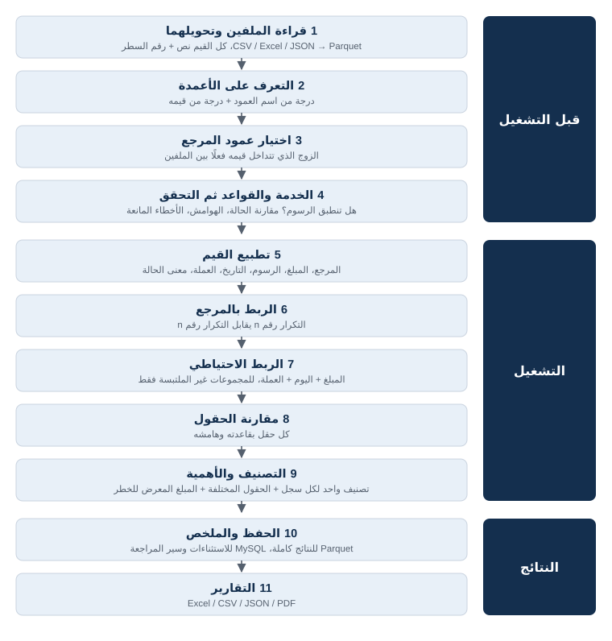
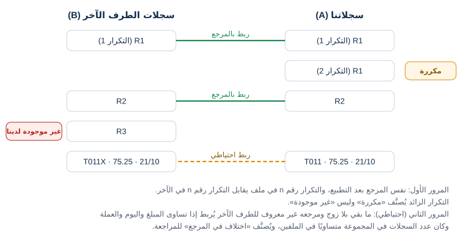
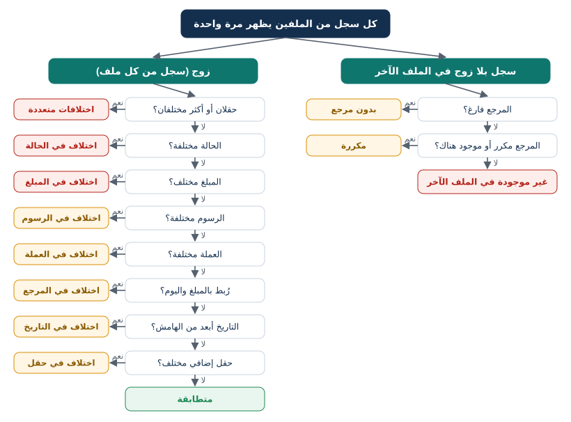

# خوارزمية المطابقة في Zaho Reconcile

> هذا المستند يشرح ما يحدث داخل النظام خطوة بخطوة: كيف يقرأ الملفين، وكيف يعرف أي عمود هو المرجع وأيها المبلغ، وكيف يربط السجلات، وكيف يقارن كل حقل، ولماذا يحصل كل سجل على تصنيفه. جدول النتائج في المثال العملي (القسم 14) ليس مكتوبًا باليد، بل ناتج عن تشغيل محرك المطابقة الفعلي عبر `_build/build.py`.

## المصطلحات

| المصطلح | المعنى |
|---|---|
| الطرف A (سجلاتنا) | الملف المستخرج من نظامنا. |
| الطرف B (سجلات الطرف الآخر) | ملف الشريك أو المصرف أو مزود الخدمة. |
| سجل | سطر واحد في أحد الملفين. |
| زوج | سجل من A وسجل من B تم ربطهما على أنهما العملية نفسها. |
| استثناء | أي نتيجة غير «متطابقة»؛ تُحفظ في MySQL لتتم مراجعتها. |
| المبلغ المعرض للخطر | تقدير لقيمة المال المتأثر بالاختلاف، ويُستخدم لترتيب الاستثناءات. |
| التطبيع | تحويل القيمة المكتوبة إلى شكل موحد قبل المقارنة (مثل `1,250.00` ← `1250`). |

# 1. المراحل باختصار



كل المراحل من 5 إلى 9 تعمل داخل قاعدة بيانات تحليلية مدمجة (DuckDB) على ملفات Parquet، لذلك يبقى استهلاك الذاكرة محدودًا حتى مع ملفات حجم كل منها 1 جيجابايت.

# 2. قراءة الملفين وتحويلهما

- **الأنواع المقبولة:** CSV وTXT وTSV وExcel (XLSX وXLS وXLSB وODS) وJSON وJSONL وParquet، حتى 1 جيجابايت لكل ملف.
- **ملفات CSV:** يُفحص الترميز أولًا؛ إذا لم يكن UTF-8 يُختار الأقرب من بين Windows-1256 وWindows-1252 وISO-8859-6 وLatin-1 وUTF-16، ثم يُحوَّل الملف إلى UTF-8، فتظهر الحروف العربية صحيحة. الفاصل وعلامة الاقتباس ووجود صف العناوين تُكتشف تلقائيًا من عينة حتى 50,000 سطر، والأسطر التالفة تُتخطى مع تنبيه.
- **ملفات Excel:** تُقرأ أول 40 صفًا لإيجاد صف العناوين الحقيقي، فتُتجاهل عناوين التقارير والأسطر الفارغة فوق الجدول. ويمكن اختيار ورقة العمل.
- **الناتج:** ملف `data.parquet` لكل طرف، فيه كل عمود محفوظ **كنص كما هو** حتى لا يتحول `000123` إلى `123` ولا يضيع شكل المبلغ الأصلي، مع عمود إضافي `__row` يحمل رقم السطر في الملف الأصلي (صف العناوين هو السطر 1، فأول سجل هو السطر 2). هذا الرقم يظهر في كل نتيجة وفي التقارير، فيمكن الرجوع إلى السطر الأصلي مباشرة.

# 3. التعرف على الأعمدة

لكل عمود في كل ملف يحسب النظام ست درجات، واحدة لكل دور: المرجع، المبلغ، الحالة، التاريخ، العملة، الرسوم. كل درجة تجمع إشارتين مستقلتين: **اسم العمود** و**قيمه**. الاسم وحده قد يخدع (عمود اسمه ID قد يكون رقم الزبون)، والقيم وحدها غامضة (رقم طويل قد يكون مرجعًا أو مبلغًا)، لذلك تُمزج الإشارتان.

## 3.1 درجة الاسم

يُوحَّد اسم العمود أولًا: أحرف صغيرة، حذف التشكيل والتطويل، توحيد (أ، إ، آ ← ا) و(ى ← ي) و(ة ← ه)، تحويل الأرقام العربية الهندية إلى لاتينية، وتحويل الرموز (`_ - . / : #` …) إلى مسافات. ثم يُقارن بقائمة مرادفات عربية وإنجليزية لكل دور:

| مطابقة الاسم | الدرجة | مثال (دور المرجع) |
|---|---|---|
| الاسم هو أحد المرادفات تمامًا | 1.0 | `Reference`، `الرقم المرجعي` |
| مرادف من عدة كلمات موجود ككلمات كاملة داخل الاسم | 0.8 | `Bank Transaction ID` |
| مرادف من كلمة واحدة موجود ككلمة كاملة | 0.7 | `Ref Code` |
| كل كلمات مرادف متعدد الكلمات موجودة بترتيب آخر | 0.7 | `ID Transaction` |
| المرادف (4 أحرف فأكثر) جزء من كلمة | 0.5 | `TxnReference` |

## 3.2 درجة القيم

تُؤخذ عينة عشوائية ثابتة حتى 5,000 صف، ويُحسب منها: نسبة القيم التي تبدو مبالغ، نسبة القيم العشرية، نسبة الأرقام الطويلة (9 خانات فأكثر، وهي غالبًا مراجع أو أرقام هواتف)، نسبة كلمات الحالة المعروفة، نسبة رموز العملات، نسبة القيم المقروءة كتاريخ، إضافة إلى **التفرد** (عدد القيم المختلفة ÷ عدد القيم المملوءة) و**الامتلاء** (نسبة الخلايا غير الفارغة).

## 3.3 المعادلات

```
المرجع   = 0.45×الاسم + 0.35×التفرد + 0.20×الامتلاء
           ×0.3 إذا كان العمود تواريخ، أو عمود مال عشري اسمه يدل على مبلغ أو رسوم
           ×0.5 إذا كان التفرد أقل من 50%، و×0.5 إذا كان متوسط طول القيم أقل من 3
المبلغ   = 0.50×الاسم + 0.35×نسبة القيم الرقمية + 0.15×نسبة العشرية
           ×0.3 إذا كانت القيم الرقمية أقل من 80%، أو أرقامًا طويلة بلا كسور، أو تواريخ
الحالة   = 0.50×الاسم + 0.50×نسبة كلمات الحالة        (×0.3 إذا كان للعمود أكثر من 40 قيمة مختلفة)
التاريخ  = 0.35×الاسم + 0.65×نسبة القيم المقروءة كتاريخ (×0.4 إذا كانت أقل من 60%)
العملة   = 0.50×الاسم + 0.50×نسبة رموز العملات        (×0.3 إذا كان للعمود أكثر من 40 قيمة مختلفة)
الرسوم   = 0.50×الاسم + 0.35×نسبة القيم الرقمية + 0.15×نسبة العشرية
           ×0.3 إذا كان الاسم لا يدل على رسوم (أقل من 0.5)، أو القيم غير رقمية، أو تواريخ
```

الحد الأدنى لقبول الدور: المرجع 0.45، المبلغ 0.45، الحالة 0.40، التاريخ 0.45، العملة 0.45، الرسوم 0.50. بعدها يتم **الإسناد الجشع**: تُرتب كل الأزواج (عمود، دور) من الأعلى درجة إلى الأدنى، ويأخذ كل دور عمودًا واحدًا فقط، ولا يأخذ أي عمود أكثر من دور.

## 3.4 اختيار عمود المرجع بالتداخل الفعلي للقيم

الاسم لا يكفي لعمود المرجع، فالمهم أن تكون القيم **مشتركة فعلًا** بين الملفين:

1. لكل ملف تُختار حتى 3 أعمدة مرشحة: تفردها 30% فأكثر، ودرجتها كمرجع 0.25 فأكثر (فتُستبعد أعمدة المبالغ والرسوم والتواريخ مهما كانت قيمها متفردة)، ويُضاف العمود الذي اختارته المعادلات.
2. تُجرب الأزواج بترتيب درجتها كمرجع. لكل زوج تُسحب عينة ثابتة من 4,000 قيمة من الطرف B، ويُحسب كم منها موجود في أي مكان في الطرف A (مرور واحد على A مع ربط بجدول تجزئة)، مع تجاهل حالة الأحرف.
3. الدرجة = نسبة التداخل + 0.15 × متوسط درجتي العمودين كمرجع، ويتوقف البحث عند أول زوج تداخله 90% فأكثر، فلا يحتاج ملف بحجم 1 جيجابايت عادة إلا إلى مرور واحد.
4. إذا كان التداخل مع **تجاهل الرموز والأصفار البادئة** أعلى بأكثر من 5 نقاط مئوية، يُقترح هذا الوضع لمطابقة المرجع.

## 3.5 الحقول الموجودة في ملف واحد والأعمدة المشتركة

- إذا وُجد دور في ملف واحد فقط، يُعطى في الملف الآخر للعمود الذي يحمل الاسم نفسه إن وجد.
- أي عمود آخر يحمل الاسم نفسه في الملفين (مثل `Channel`) يُقارن أيضًا، لكن فقط إذا كان امتلاؤه 5% فأكثر و30% فأكثر من قيم B (عينة 2,000) موجودة في A، حتى لا يتحول عمود «ملاحظات» مكتوب بطريقتين مختلفتين إلى آلاف الاختلافات. الحد الأقصى 6 حقول إضافية.
- كل هذا يظهر في خطوة «الحقول» للقراءة فقط، ويمكن تصحيحه من زر «تصحيح التعرف».

# 4. الخدمة ومطابقة الرسوم / الإيراد

- قائمة **الخدمات** محفوظة في MySQL (جدول `services`)، ولكل خدمة: الاسم، وهل تنطبق عليها مطابقة الرسوم / الإيراد، وهل تظهر عند بدء مطابقة جديدة. يديرها المسؤول من صفحة «الخدمات والحالات».
- في خطوة «القواعد» يُسأل سؤال واضح: **هل تنطبق مطابقة الرسوم / الإيراد؟** اختيار الخدمة يملأ الإجابة تلقائيًا، ويمكن تغييرها لهذه المطابقة فقط. بدون خدمة تكون الإجابة الافتراضية «نعم» إذا وُجد عمود رسوم في الملفين، و«لا» إذا لم يوجد.
- **نعم:** تُقارن الرسوم بالهامش نفسه المستخدم للمبلغ. رسوم موجودة في طرف وفارغة في الآخر تُعدّ اختلافًا في الرسوم، والرسوم غير المقروءة لا تُعتبر صفرًا أبدًا وتظهر في التحقق وفي جودة البيانات.
- **لا:** تُتجاهل أعمدة الرسوم تمامًا حتى لو وُجدت في الملفين.
- **نعم بدون عمود رسوم في أحد الملفين:** خطأ يمنع التشغيل (في خطوة التحقق وعلى الخادم).
- تُحفظ مع المطابقة نسخة من الخدمة (الاسم والإعداد كما كانا وقت التشغيل) والإجابة، وتظهر في صفحة النتيجة وفي تقارير Excel وPDF. «إعادة التشغيل» تحتفظ بإجابة المطابقة الأصلية.

# 5. مقارنة الحالة

لكل قيمة حالة **معنى** واحد من: ناجحة `SUCCESS`، فاشلة `FAILED`، قيد المعالجة `PENDING`، ملغاة `CANCELLED`، مسترجعة `REVERSED`، أو غير معروفة `UNKNOWN`. طريقة إعطاء المعنى تُختار لكل مطابقة:

## 5.1 المطابقة التامة بالأسماء المعتمدة (الافتراضية)

- يُتجاهل فقط **حالة الأحرف والمسافات حول القيمة**؛ لا توجد أي مرادفات مدمجة.
- قائمة **أسماء الحالات المعتمدة** محفوظة في MySQL (جدول `status_names`)، وكل اسم مرتبط بمعنى. القائمة الافتراضية تحتوي الأسماء الرسمية فقط: `SUCCESS` و`SUCCEEDED` (ناجحة)، `FAILED`، `PENDING`، `CANCELLED`، `REVERSED`. أي اسم آخر (مثل `Approved` أو «ناجحة») لا يُضاف إلا بعد اعتماده من الإدارة.
- القيمة الموجودة في القائمة تأخذ معناها، وغيرها يصبح `UNKNOWN`. ثم:

| الطرف A | الطرف B | النتيجة | السبب |
|---|---|---|---|
| `SUCCEEDED` | ` succeeded ` | متساويتان | اختلاف حالة الأحرف والمسافات فقط |
| `SUCCEEDED` | `Approved` | مختلفتان | `Approved` غير معتمد، فمعناه غير معروف |
| `FAILED` | `Declined` | مختلفتان | `Declined` غير معتمد |
| `Done` | `done` | متساويتان | كلتاهما غير معتمدة لكنهما النص نفسه |
| `Done` | `Completed` | مختلفتان | نصان مختلفان غير معتمدين |

- القائمة **تُنسخ مع كل مطابقة** وقت تشغيلها، فتعديل القائمة لاحقًا لا يغيّر نتائج قديمة، وتظهر القائمة المستخدمة في التقارير. «إعادة التشغيل» تأخذ القائمة كما هي الآن، فيظهر أثر الأسماء التي اعتُمدت بعد التشغيل الأول.
- في هذا الوضع لا يمكن تصحيح معنى حالة داخل مطابقة واحدة؛ الطريق الوحيد لاعتبار اسمين متساويين هو اعتماده في القائمة.

## 5.2 المقارنة التلقائية

قاموس مدمج بالعربية والإنجليزية ورموز ISO-8583 يقرأ مثلًا `Approved` و`Paid` و«ناجحة» و«تمت بنجاح» و`00` على أنها ناجحة، و`Declined` و«مرفوضة» و`51` على أنها فاشلة، ويبحث داخل القيم متعددة الكلمات (`Transaction Successful`). يمكن تصحيح معنى أي قيمة لهذه المطابقة من «تصحيح التعرف». هذا الوضع مفيد مع ملفات شريك جديد قبل اعتماد أسمائه، وتستخدمه بيانات العرض التجريبي.

## 5.3 أين يُستخدم المعنى

المعنى هو ما يُقارن، وهو ما يحدد **الأهمية** (ناجحة في طرف وفاشلة في الآخر اختلاف حرج)، و**إجمالي العمليات الناجحة** في كل طرف، و**مصفوفة مقارنة الحالات** في التقارير. النص الأصلي للحالة يُحفظ دائمًا ويظهر بجانب المعنى.

# 6. خطوة التحقق قبل التشغيل

بعد «القواعد» تأتي خطوة «التحقق»: يقرأ الخادم الملفين بالقواعد المختارة وبطريقة التحليل نفسها التي يستخدمها التشغيل (مرور واحد على كل ملف)، ويعرض:

1. **أخطاء تمنع التشغيل:** طرف بلا عمود مرجع؛ عمود واحد مستخدم لحقلين؛ مطابقة الرسوم مطلوبة ولا يوجد عمود رسوم في أحد الطرفين. زر «بدء المطابقة» يبقى معطلًا، والخادم يرفض الطلب أيضًا لو وصل.
2. **لكل ملف:** عدد السجلات، السجلات بدون مرجع، المراجع المكررة، المبالغ الفارغة وغير المقروءة، الرسوم الفارغة وغير المقروءة، التواريخ غير المقروءة، الحالات الفارغة، والحالات غير المعتمدة (أو غير المعروفة في الوضع التلقائي).
3. **قيم الحالة الموجودة** في كل ملف، ومعنى كل منها كما سيستخدمه التشغيل.
4. **الحقول الموجودة في ملف واحد فقط** والتي لن تُقارن.
5. ملخص ما ستستخدمه المطابقة: الخدمة، هل تُقارن الرسوم، طريقة مقارنة الحالة، مطابقة المرجع، الهامش.

# 7. تطبيع القيم

## 7.1 تنظيف عام لكل خلية

حذف المسافات حول القيمة (بما فيها المسافة غير القابلة للكسر)، وتحويل الأرقام العربية الهندية (٠١٢…) والفاصلة العشرية العربية (٫) والسالب الطباعي (−) إلى مقابلاتها اللاتينية، واعتبار الخلية الفارغة «لا قيمة» وليس صفرًا.

## 7.2 المرجع

| الوضع | ما يُتجاهل | أمثلة متساوية | أمثلة مختلفة |
|---|---|---|---|
| تجاهل حالة الأحرف والمسافات (الافتراضي) | حالة الأحرف والمسافات حول القيمة | `T013` و` t013 ` | `ZH-12` و`ZH12` |
| مطابقة تامة | المسافات حول القيمة فقط | `ZH-0012` و`ZH-0012` | `ZH-0012` و`zh-0012` |
| تجاهل الرموز والأصفار البادئة | كل ما ليس حرفًا لاتينيًا أو رقمًا، والأصفار في بداية الرقم أو بعد البادئة الحرفية | `ZH-0012` و`zh0012` و`ZH12` | `1005` و`105` (الصفر داخل الرقم يبقى) |

## 7.3 المبلغ والرسوم (قراءة صارمة)

يُكتشف شكل الأرقام لكل عمود (`1,234.56` أو `1.234,56`). ثم تُقبل القيمة فقط إذا كانت سلسلة واحدة من الأرقام والفواصل في أماكن صحيحة، مع إشارة أو أقواس أو كلمة عملة حولها. أي قيمة غامضة تُعدّ **غير مقروءة** وتظهر في جودة البيانات، ولا تتحول أبدًا إلى رقم خاطئ:

| القيمة | تُقرأ كـ | ملاحظة |
|---|---|---|
| `1,250.00` | 1250 | فاصل آلاف صحيح |
| `(100)` أو `100-` أو `−100` | 100- | كلها سالبة |
| `LYD 5.00` | 5 | كلمة عملة حول الرقم |
| `1.5E3` | 1500 | صيغة علمية |
| `١٢٣٫٥` | 123.5 | أرقام عربية وفاصلة عربية |
| `1,5` في عمود بشكل `1,234.56` | غير مقروءة | الفاصلة ليست في مكان آلاف صحيح |
| `12a34` | غير مقروءة | حروف داخل الرقم |
| `2026-10-01` | غير مقروءة | تاريخ وليس مبلغًا |

الحساب يتم بأرقام عشرية دقيقة (38 خانة، منها 6 بعد الفاصلة) وليس بأرقام عائمة، فلا تظهر فروق تقريب مثل 0.0000001. خيار «مقارنة المبالغ بدون إشارة» يقارن القيمة المطلقة، وهو مفيد عندما يكتب أحد الطرفين المرتجعات بالسالب.

## 7.4 التاريخ

يُقرأ ISO مباشرة (مع حذف لاحقة المنطقة الزمنية)، ثم الأشكال المكتشفة للعمود من عينة القيم، مع تفضيل اليوم أولًا (`05/06/2026` = 5 يونيو) عند الالتباس لأنه الشكل المستخدم في ليبيا. أرقام Excel التسلسلية (`46313.5`) تُقرأ فقط إذا كان اسم العمود يدل على تاريخ، حتى لا تُقرأ المبالغ ذات الخمس خانات كتواريخ. المقارنة تتم **باليوم التقويمي**.

## 7.5 العملة

`د.ل` و`دينار` و`دينار ليبي` و`LD` ← `LYD`، و`$` و«دولار» ← `USD`، و`€` و«يورو» ← `EUR`، و`£` ← `GBP`، وأي قيمة أخرى تُكتب بأحرف كبيرة.

# 8. ربط السجلات



## 8.1 المرور الأول: المرجع

لكل سجل يُحسب المرجع بعد التطبيع، ورقم تكراره داخل ملفه (الأول، الثاني…) بترتيب الأسطر. يُربط سجل من A بسجل من B إذا تساوى **المرجع ورقم التكرار معًا**. هذا يعني أن مرجعًا موجودًا مرتين في A ومرة في B يُربط تكراره الأول، ويبقى الثاني بلا زوج فيُصنَّف «مكررة» وليس «غير موجودة». الربط يتم بجدول تجزئة في مرور واحد، فتكلفته تقريبًا خطية في عدد الأسطر.

## 8.2 المرور الثاني: المبلغ واليوم (احتياطي، مفعّل افتراضيًا)

السجلات التي بقيت بلا زوج، ومرجعها فارغ أو غير موجود في الطرف الآخر، تُجمع في مجموعات حسب (المبلغ، اليوم، العملة). يُربط السجل رقم n في مجموعة من A بالسجل رقم n في المجموعة نفسها من B (بترتيب الوقت) **فقط إذا كان عدد سجلات المجموعة متساويًا في الطرفين**. إذا كان هناك سجلان بمبلغ 70 في يوم واحد لدينا وسجل واحد لديهم، لا يُخمَّن أي ربط. الأزواج الناتجة تُصنَّف «اختلاف في المرجع» لتتم مراجعتها.

# 9. مقارنة الحقول

لكل زوج يُقارن كل حقل مربوط في الملفين بقاعدته:

| الحقل | يُعدّ متساويًا إذا | ملاحظات |
|---|---|---|
| المبلغ | الفرق المطلق ≤ الهامش الثابت، أو (إذا حُدد هامش نسبي) الفرق ≤ النسبة × أكبر القيمتين | الهامش الافتراضي 0؛ فارغ في الطرفين = متساويان؛ فارغ في طرف واحد = مختلفان |
| الرسوم | القاعدة نفسها والهامش نفسه | فقط إذا كانت مطابقة الرسوم / الإيراد تنطبق |
| الحالة | حسب طريقة المقارنة (القسم 5) | |
| التاريخ | فرق الأيام التقويمية ≤ هامش الأيام | الافتراضي يوم واحد؛ يمكن إيقاف مقارنة التاريخ |
| العملة | الرمز نفسه بعد التطبيع | يمكن إيقافها |
| الحقول الإضافية | النص نفسه مع تجاهل حالة الأحرف | |

# 10. التصنيف



- **كل سجل من الملفين يظهر مرة واحدة بالضبط** في النتائج، فمجموع التصنيفات = عدد الأزواج + السجلات بلا زوج في الطرفين.
- إذا اختلف **حقلان أو أكثر** في زوج واحد (من الحالة والمبلغ والرسوم والعملة والتاريخ والحقول الإضافية) يكون التصنيف «اختلافات متعددة». الربط الاحتياطي لا يُحسب حقلًا، لأنه طريقة الربط وليس قيمة.
- مع كل نتيجة يُحفظ عمود `mismatch` الذي يذكر **كل** الحقول المختلفة، فيرى المراجع كل شيء حتى لو كان التصنيف لحقل واحد، وتُلوَّن الخلايا المختلفة في الشاشة وفي Excel.

| التصنيف | المعنى |
|---|---|
| متطابقة | كل ما قورن متساوٍ. |
| اختلافات متعددة | حقلان أو أكثر مختلفان في العملية نفسها. |
| اختلاف في الحالة | الحالة وحدها مختلفة. |
| اختلاف في المبلغ | المبلغ وحده مختلف بأكثر من الهامش. |
| اختلاف في الرسوم | الرسوم وحدها مختلفة. |
| اختلاف في العملة | العملة وحدها مختلفة. |
| اختلاف في المرجع | الزوج رُبط بالمبلغ واليوم لأن المرجعين مختلفان. |
| اختلاف في التاريخ | التاريخ وحده أبعد من الهامش. |
| اختلاف في حقل | حقل إضافي مختلف. |
| غير موجودة لدى B / لدى A | السجل في ملف واحد فقط. |
| مكررة لدى A / لدى B | المرجع يتكرر في ملفه أكثر مما في الملف الآخر. |
| بدون مرجع | سجل بلا مرجع ولم يجد زوجًا بالمبلغ واليوم. |

# 11. الأهمية والمبلغ المعرض للخطر

| التصنيف | الأهمية | المبلغ المعرض للخطر |
|---|---|---|
| اختلافات متعددة | حرجة إذا كانت الحالة ناجحة في طرف فقط، أو المبلغ مختلفًا مع عملية ناجحة؛ عالية إذا اختلفت العملة؛ وإلا متوسطة | الأكبر من: فرق المبلغ، فرق الرسوم، مبلغ العملية الناجحة (إن اختلفت الحالة)، المبلغ (إن اختلفت العملة) |
| اختلاف في الحالة | حرجة إذا كانت ناجحة في طرف وغير ناجحة في الآخر، وإلا منخفضة | مبلغ الطرف الذي يقول إنها ناجحة |
| اختلاف في المبلغ | حرجة إذا كانت العملية ناجحة (أو لا توجد حالة)، وإلا متوسطة | الفرق المطلق |
| غير موجودة | حرجة إذا كانت ناجحة، منخفضة إذا كانت فاشلة أو ملغاة، وإلا عالية | المبلغ (صفر إذا كانت فاشلة أو ملغاة) |
| مكررة | عالية | المبلغ |
| اختلاف في العملة | عالية | المبلغ |
| اختلاف في الرسوم | متوسطة | فرق الرسوم |
| اختلاف في المرجع / التاريخ / بدون مرجع | متوسطة | صفر للأزواج، والمبلغ للسجل بلا زوج |
| اختلاف في حقل | منخفضة | صفر |

الاستثناءات تُرتب للمراجعة حسب التصنيف ثم الأهمية ثم رقم السطر.

# 12. الملخص وجودة البيانات والتخزين

- **الملخص:** عدد السجلات في كل طرف، نسبة التطابق، إجمالي المبالغ وإجمالي العمليات الناجحة في كل طرف والفرق بينهما، إجمالي الرسوم عند مقارنتها، عدد كل تصنيف ومبالغه، توزيع الأهمية، مصفوفة الحالات، والتوزيع اليومي.
- **جودة البيانات:** لكل طرف عدد السجلات بدون مرجع، والمبالغ والرسوم والتواريخ غير المقروءة، والحالات غير المعروفة أو غير المعتمدة، والمراجع المكررة.
- **التخزين:** النتائج الكاملة في ملفين Parquet بجانب المطابقة: `results_x.parquet` للاستثناءات مرتبة، و`results_m.parquet` للمتطابقة بترتيب الملف (فلا تحتاج ملايين الأسطر المتطابقة إلى ترتيب عام). الاستثناءات تُنسخ إلى MySQL دفعة واحدة (حتى `MAX_DB_EXCEPTIONS`، افتراضيًا مليون) مع حالة المراجعة والمسؤول والملاحظات والتعليقات وسجل التغييرات.
- **التقارير:** Excel (ملخص مع رسم بياني، ورقة لكل تصنيف، أعمدة الملفين الأصلية جنبًا إلى جنب، وخلايا الاختلاف ملونة)، CSV مضغوط، JSON، وتقرير PDF للإدارة. كلها تذكر القواعد المستخدمة: الخدمة، مطابقة الرسوم، طريقة مقارنة الحالة، والأسماء المعتمدة.

# 13. الأداء مع الملفات الكبيرة

- كل خطوة تعمل كاستعلام SQL في DuckDB على ملفات Parquet مضغوطة، بعدة أنوية، مع حد ذاكرة (`DUCKDB_MEMORY_LIMIT`، افتراضيًا 4 جيجابايت) يُفرغ الزائد إلى `data\tmp` بدل أن تنفد الذاكرة.
- كل خلية تُنظف مرة واحدة فقط؛ القيم العادية تُحوَّل مباشرة، والقيم الغريبة فقط تمر بالتحليل الأبطأ.
- مقاسة على هذا الجهاز (i5-1335U، ذاكرة 16 جيجابايت) بملفين حجمهما 990 و914 ميجابايت (12.5 مليون سطر لكل منهما، و72,000 اختلاف مزروع): القراءة والتعرف 12 إلى 16 ثانية لكل ملف، والمطابقة كاملة مع حفظ الاستثناءات في MySQL نحو 85 ثانية، وكل الأعداد طابقت الاختلافات المزروعة تمامًا.

# 14. مثال عملي

الملفان في مجلد `example`: الملف `our_records.csv` (15 سجلًا، تواريخ ISO) والملف `their_records.csv` (14 سجلًا، تواريخ بشكل يوم/شهر/سنة، وأسماء أعمدة مختلفة: `Reference` و`Value Date` و`Commission` و`Result`). التعرف التلقائي يربط الأعمدة صحيحًا، والقواعد المستخدمة: مطابقة المرجع بتجاهل حالة الأحرف والمسافات، هامش المبلغ 0، هامش التاريخ يوم واحد، مطابقة الرسوم تنطبق، الربط الاحتياطي مفعّل، والأسماء المعتمدة هي القائمة الافتراضية.

<!-- example-results:start -->
| # | المرجع لدينا | المرجع لديهم | النتيجة (مقارنة تامة) | الأهمية | الحقول المختلفة | المبلغ المعرض للخطر | النتيجة (مقارنة تلقائية) |
|---|---|---|---|---|---|---|---|
| 1 | `T001` | `T001` | متطابقة | — | — | 0.00 | متطابقة |
| 2 | `T002` | `T002` | اختلاف في الحالة | حرجة | الحالة | 200.00 | اختلاف في الحالة |
| 3 | `T003` | `T003` | اختلاف في المبلغ | حرجة | المبلغ | 5.00 | اختلاف في المبلغ |
| 4 | `T004` | `T004` | اختلاف في الرسوم | متوسطة | الرسوم | 0.30 | اختلاف في الرسوم |
| 5 | `T005` | `T005` | اختلافات متعددة | حرجة | الحالة، المبلغ | 300.00 | اختلافات متعددة |
| 6 | `T006` | — | غير موجودة لدى الطرف الآخر | حرجة | — | 120.00 | غير موجودة لدى الطرف الآخر |
| 7 | `T008` | `T008` | متطابقة | — | — | 0.00 | متطابقة |
| 8 | `T009` | `T009` | اختلاف في التاريخ | متوسطة | التاريخ | 0.00 | اختلاف في التاريخ |
| 9 | `T010` | `T010` | اختلاف في العملة | عالية | العملة | 90.00 | اختلاف في العملة |
| 10 | `T011` | `T011X` | اختلاف في المرجع | متوسطة | المرجع | 0.00 | اختلاف في المرجع |
| 11 | — | — | بدون مرجع لدينا | متوسطة | — | 33.30 | بدون مرجع لدينا |
| 12 | `T012` | `T012` | اختلاف في الحالة | حرجة | الحالة | 40.00 | **متطابقة** |
| 13 | `t013` | `T013` | متطابقة | — | — | 0.00 | متطابقة |
| 14 | `T014` | `T014` | متطابقة | — | — | 0.00 | متطابقة |
| 15 | `T015` | — | غير موجودة لدى الطرف الآخر | منخفضة | — | 0.00 | غير موجودة لدى الطرف الآخر |
| 16 | — | `T007` | غير موجودة لدينا | حرجة | — | 45.00 | غير موجودة لدينا |
| 17 | — | `T008` | مكررة لدى الطرف الآخر | عالية | — | 80.00 | مكررة لدى الطرف الآخر |
<!-- example-results:end -->

ملاحظات على السطور:

- `T001`: العملة لديهم مكتوبة `د.ل` وتُقرأ `LYD`، فتتطابق.
- `T005`: المبلغ والحالة مختلفان معًا، فالتصنيف «اختلافات متعددة»، والمبلغ المعرض للخطر هو مبلغ العملية الناجحة (300) لأنه أكبر من فرق المبلغ (10).
- `T008`: مكرر لديهم؛ التكرار الأول يتطابق والثاني «مكررة».
- `T009`: الفرق 3 أيام والهامش يوم واحد.
- `T011` و`T011X`: المرجعان مختلفان، لكن المبلغ واليوم والعملة متساوية ولا يوجد التباس، فيُربطان احتياطيًا.
- السجل بلا مرجع (33.30): لا يوجد سجل لديهم بالمبلغ واليوم نفسيهما، فيبقى «بدون مرجع».
- `T012`: `SUCCEEDED` مقابل `Approved`. في المقارنة التامة `Approved` غير معتمد فهو اختلاف حرج، وفي المقارنة التلقائية يُقرأ «ناجحة» فيتطابق. اعتماد `Approved` في صفحة «الخدمات والحالات» يجعل المقارنة التامة تتطابق أيضًا.
- `t013` و` T013 ` مع `FAILED` و`failed `: تتطابق لأن حالة الأحرف والمسافات لا تؤثر.
- `T014`: `1,250.00` لدينا و`1250` لديهم هما المبلغ نفسه.
- `T015`: غير موجود لديهم لكنه فاشل، فأهميته منخفضة ومبلغه المعرض للخطر صفر.

لتجربة المثال في النظام: ارفع الملفين في «مطابقة جديدة»، ثم في «القواعد» اختر «نعم» لمطابقة الرسوم واترك الباقي كما هو. النتيجة ستطابق الجدول أعلاه (ملف `example/results.csv` يحتوي النتائج نفسها).

# 15. حدود معروفة

> حدود يجب معرفتها قبل الاعتماد على النتائج:
> - الربط **واحد لواحد** فقط؛ سطر تسوية واحد يمثل عدة عمليات لا يُربط بها.
> - المرجع المكرر يُربط بالترتيب (التكرار n مع التكرار n)، والزائد «مكررة»؛ لا يُصنَّف كله كـ«ملتبس».
> - الربط الاحتياطي يشترط المبلغ نفسه تمامًا واليوم نفسه.
> - في الملفات الصغيرة جدًا قد يخطئ التعرف التلقائي على الأعمدة، لذلك تُعرض النتيجة دائمًا ويمكن تصحيحها.
> - الرسوم الفارغة في الطرفين تُعدّ متساوية؛ عددها يظهر في خطوة التحقق.
> - النتائج أداة مساعدة للمراجعة، وليست تقريرًا مدققًا.
